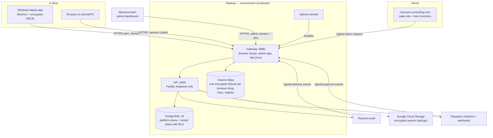

# Mansora Sales & Stock — system design

Current architecture as deployed on 15 November 2026. Companion documents: `overview.md` (laptop engine, sync,
tenant isolation in depth), `api.md`, `../operations/environments.md`, `../operations/railway-control-register.md`,
`../legal/data-inventory.md`.

## 1. Purpose and shape

Mansora is a point-of-sale and stock system for Ghanaian shops, sold as a subscription by Mansora Consulting. A
shop uses it on a **Windows laptop** (works offline, syncs when online) or in a **browser** (hosted shop). Mansora
runs a **platform** that keeps every shop's synced records, bills shops for the subscription, and handles new
customers from the website through to go-live.

## 2. Components

| Component | Code | Runs on | Responsibility |
| --- | --- | --- | --- |
| Laptop app | `apps/desktop` (Electron main + React renderer) | shop's Windows PC | Selling, stock, credit, shifts, expenses, reports, statements; **system of record for its shop**; outbox for sync |
| Command engine | `apps/desktop/src/core` | laptop, and inside the gateway for browser shops | One `execute(command)` entry point: authentication, permissions, validation, business rules, transactions, audit, outbox |
| Gateway | `scripts/staging/gateway.ts`, `scripts/railway/server.ts` | Railway web service | Serves browser shops (one engine + encrypted store per shop), the admin dashboard, proxies `/api/*` to the API, session cookies, rate limits, CSP, snapshot lock for backups |
| API | `apps/api` (Fastify) | same Railway service, port 4000 on loopback only | Device activation and sync ingest, admin, billing, leads, webhooks, email queue, jobs |
| Admin dashboard | `apps/admin-web` (React) | served by the gateway | Clients, leads, plans, subscriptions, invoices, payments, revenue, audit, administrators, problem reports |
| Domain package | `packages/domain` | shared | Money in pesewas, sale/refund/shift maths, permissions, sync contract, presets, VAT |
| Corporate website | `priscillafm03-afk/mansora-website` | Vercel | Marketing pages, consulting Contact Us (own flow), **software demo form** forwarded to the platform |
| Uptime monitor | `scripts/monitor` | separate Railway service | Checks production health; alert, reminder and recovery emails |
| Background jobs | `apps/api/src/billing/jobs.ts`, `scripts/railway/server.ts` | inside the web service, every 15 min | Invoices and reminders, email delivery, problem-report digest (19:00), browser-shop sync, scheduled backups |

## 3. Environments and release path

| | Development | Staging | Production |
| --- | --- | --- | --- |
| Where | developer machine, GitHub Actions | Railway `staging` | Railway `production`, `app.mansora-consulting.com` |
| Code | any branch / PR | main branch, every merge | `production` branch, moved only by *Promote to production* |
| Data | synthetic, discarded | sample shops, its own database and volume | live shops and clients |
| Email | mocked | team inbox only | allow-list until go-live (team-test mode) |

Gate: 20 CI checks per pull request → merge → staging → approved promotion (all checks green, fast-forward only,
approver recorded) → production. Details: `../operations/environments.md`.

## 4. Data stores

| Store | Holds | Protection |
| --- | --- | --- |
| Laptop SQLite (SQLCipher) | the shop's complete records, staff logins, outbox | AES encryption, key tied to the Windows account; WAL; optional encrypted `.mbk` backups |
| Browser-shop SQLite on `/data` | same, one file per browser shop | encrypted with a per-shop key derived from a root key on the volume |
| PostgreSQL — tenant plane | every shop's synced records | row-level security: a request can only see its own tenant; only the sync and admin code paths use it |
| PostgreSQL — platform plane | clients, devices, plans, subscriptions, invoices, payments, leads, notifications, audit | separate role; no tenant role can read it |
| Notifications queue | every email, its status and delivery outcome | leased before sending; idempotency keys; retries |
| Google Cloud Storage (pending) | encrypted snapshots of database + `/data` | AES-256-GCM with a key Mansora holds; read back and verified each time; 90-day retention |

Money is always an integer number of pesewas. Sales, payments, refunds, stock movements and audit entries are
append-only; corrections are new records.

## 5. Key flows

**Sale (laptop or browser).** Cashier scans/selects items → engine prices the basket (domain rules) → one
transaction writes the sale, payments, stock movements, audit and an outbox event → receipt. Works offline.

**Sync.** The outbox sends events to `/v1/sync` with the device token; the API applies them idempotently (same
event twice changes nothing) into the tenant plane and returns what the laptop should pull (e.g. Mansora invoices
and payments, which also appear as the shop's expenses). Rejected events stay visible on the laptop.

**Mansora billing.** Plan → subscription (draft until approved) → invoice on schedule → client pays through the
pay link (Paystack checkout) or Mobile Money mandate → Paystack signed webhook → payment recorded, invoice
updated, receipt email, standing recalculated (non-payment restrictions are staged and announced).

**Customer acquisition.** Website form → signed server-to-server request → lead saved and emails queued in one
transaction (acknowledgement, team alert, follow-ups re-checked when due) → team records contact, qualifies →
explicit conversion in one transaction (client, onboarding checklist, draft subscription, welcome email) →
browser workspace link → owner sets own password → business-type preset → training → go-live. Evidence:
`../operations/acquisition/acceptance-report.md`.

**Bank and MoMo statements.** Owner uploads a PDF/Excel/CSV statement → lines read and matched to sales,
repayments, expenses and suppliers → owner accepts lines; accepted money-out lines become expenses.

**Backups.** Laptop: daily encrypted file (owner-enabled) and continuous sync. Browser version: every 6 h a
read-only snapshot of PostgreSQL and `/data` is encrypted, uploaded, read back and verified; health alerts go to
the team inbox; `scripts/recovery/restore.ts` restores into an empty database and folder.

## 6. Trust boundaries and authentication

| Boundary | How it is protected |
| --- | --- |
| Shop staff → engine | username + password (strong-password rules), sessions that lock after inactivity, per-person permissions checked on every command |
| Laptop → platform | device token from a one-time activation code; one active laptop per shop; deactivation revokes it |
| Browser → gateway | HTTPS only, same-origin checks, session cookie (HttpOnly, per shop), CSP, request size and rate limits |
| Mansora team → admin | email + password, optional TOTP two-step sign-in (should be mandatory), 12-hour sessions, audit log |
| Website → platform | HMAC-SHA256 signature with `DEMO_INTAKE_SECRET` over timestamp, visitor IP and body; 5-minute window |
| Paystack / Resend → platform | provider-signed webhooks, verified on the exact bytes, processed once |
| Platform → providers | API keys held only in Railway variables; test-mode guard refuses live payment keys on the test deployment |
| Tenant ↔ tenant | PostgreSQL row-level security; separate encrypted store per browser shop; isolation tests in CI |

## 7. Limits and failure modes

| Limit / failure | Effect | Mitigation |
| --- | --- | --- |
| One web replica (SQLite stores on one volume) | a redeploy has a brief interruption; no horizontal scaling | single volume by design; capacity 10 browser shops per instance; plan a second instance or region per group of shops |
| Railway region outage | browser shops and sync unavailable; laptops keep selling offline | restore from off-site backup to a new environment (RTO target 4 h); laptops catch up |
| Database damage | platform data lost since last good copy | off-site snapshot (RPO 6 h); laptops resend anything unacknowledged |
| Volume loss | browser shops' stores lost since last snapshot | same snapshot covers `/data` |
| Email provider down | emails wait in the queue and retry; never lost | queue + idempotency; delivery outcomes via webhook |
| Payment provider down | clients cannot pay online; nothing charged twice | invoices stay open; manual payment recording; idempotent webhooks |
| Website down | demo requests fall back to email/phone | form shows the fallback; Contact Us is independent |
| Lost/stolen laptop | that shop's unsynced records | encrypted DB; deactivate; restore backup or rebuild from cloud |

## 8. Technology

TypeScript throughout; Node 22; Electron; React 19 + Tailwind; Fastify; PostgreSQL 16; SQLite with SQLCipher
(better-sqlite3-multiple-ciphers); Vitest + Playwright; Docker image for Railway; Vercel functions for the
website. Dependencies are pinned and audited in CI.
