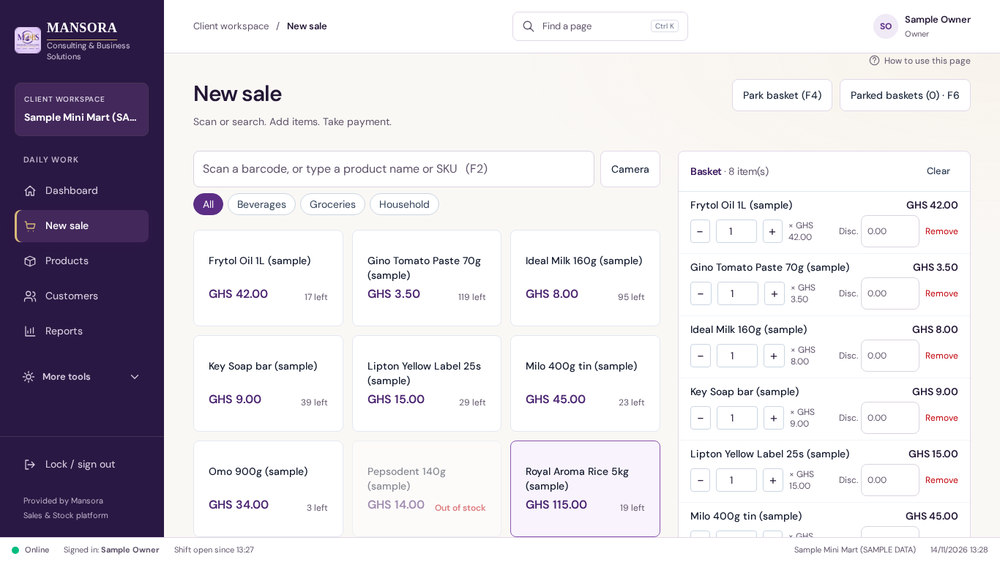
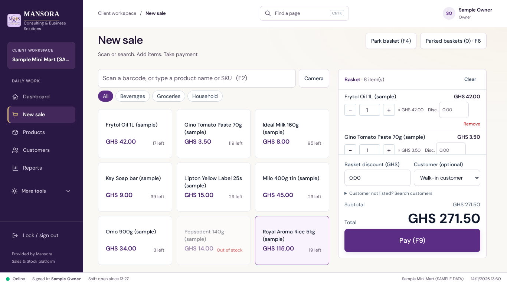
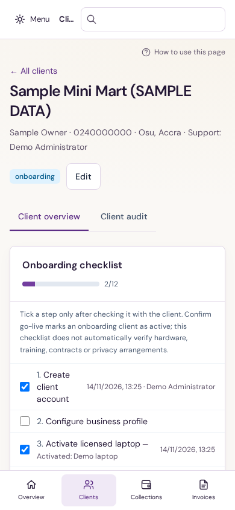
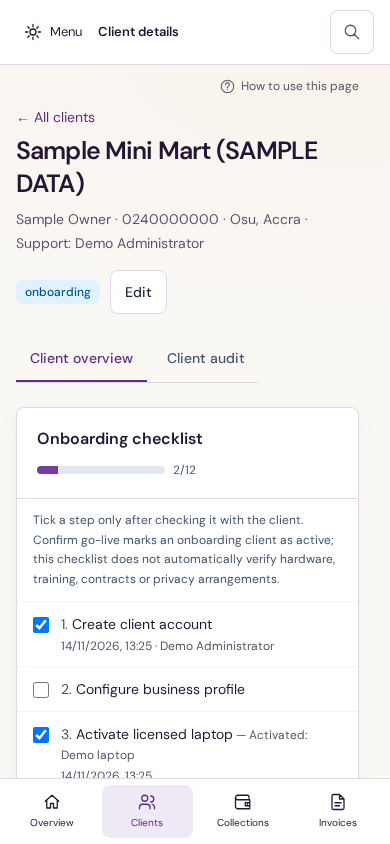

# Mansora scrolling and subpage review

Review date: 14 November 2026. Starting branch: `claude/relaxed-lovelace-0179ut`.
Starting commit: `6858afdf3159b4de25705fb3a8e44d6765ae46ba` (includes merged review fixes through PR #72).
Working branch: `codex/ux-scroll-review`. The starting checkout was clean. No AGENTS.md files were present in the checkout or workspace root.

## Result

Cashiers can browse a long catalogue and a large basket on a laptop while keeping the total and Pay action visible. Basket lines scroll independently and are keyboard reachable. On short or narrow displays the basket returns to normal page flow. Owner and operator navigation now starts committed destinations at the top, moves keyboard focus into the new page, and distinguishes client details from the directory. Mobile administration retains a readable header and onboarding tasks.

The existing DM Sans, purple/plum, restrained gold, client identity, brand assets, UI library, financial calculations, permissions, command engine and API contracts are retained. This is a focused usability pass, not a new visual brand.

## Prioritized findings

| Priority | Screen / reproduction | User impact | Final change | Verification |
| --- | --- | --- | --- | --- |
| P1 | New sale: add eight or more distinct items at 1366 × 768 | Total and Pay fall below the viewport; cashier must move away from product selection | Sticky laptop basket with bounded, named item scroll area; totals/actions remain visible; quantity controls wrap | Before Pay y≈1143, after y≈617 in the synthetic eight-item capture. Regression exercises 12 lines and 60 products at both laptop sizes, keyboard scrolling, payment opening and guarded basket clearing |
| P1 | Workspace: keyboard-open client row or follow an in-page destination | Unmounted trigger leaves focus on body; directory and client details share sidebar identity | Separate page identity including detail ID, deterministic scroll reset, labelled main and content focus; preserve checkout autofocus | Enter opens client details with focus in main; All clients returns to top with focus in main. Both shop and admin are covered |
| P2 | Admin at 390px: open a client | Search retains 240px minimum width, truncating page context | 44px compact search control; explicit Client details context | Before/after captures, header bounds and usable breadcrumb assertions at 390px and 683px |
| P2 | Admin client onboarding at 390px: read completed steps | Completion timestamp crowds task label into very narrow lines | Checkbox/label grid; completion detail sits below its task | Rendered before/after review and narrow screen sweep |
| P2 | Short viewport dialog: scroll to bottom and keep scrolling | Wheel events can scroll the workspace behind the dialog | Contain overscroll in dialog body; prevent header/footer shrinking | Keyboard body scrolling, visible Save/footer, Escape, and background scroll-position assertion at 390px and zoom-equivalent viewport |
| P2 | Import & export at 390px | Native file input extends slightly beyond page width | Bound file input width to available page space | Sweep initially measured main 377px content against 375px available; targeted final verification recorded below |
| P2 | Reports / credit tables: navigate screen-reader regions | Multiple regions have the same name; action columns have blank headings | Name regions using table context/caption; provide an Actions heading for visually blank action columns | Final axe sweep and existing labelled-table/keyboard scenarios |
| P3, remaining | Table action headers | The columns now have accessible labels but axe still flags their empty text | Retain the 23 minor scan occurrences and confirm header text/assistive-technology behavior in a follow-up | Raw axe findings retained |
| P3, remaining | Shared card headings | Many top-level cards use h3 after an h1 | Keep a separate follow-up for coherent heading levels, including nested cards and modal contents | axe reports moderate heading-order findings; no claim of complete WCAG conformance |
| Product decision, remaining | Subpages and reports | Page selection remains in React state; browser Back/deep-link behavior is not a full router | No router introduced in this pass; define URL/history and unsaved-work semantics together | Source inspection: both application go() functions update state; browser-route restoration is outside the verified changes |

## Screens and roles reviewed

The application has one platform administrator role, plus owner, manager and cashier shop roles with per-user permissions. Navigation remains permission-filtered; backend checks remain authoritative.

Shop inventory: Dashboard; Getting started; New sale and shift opening; Sales history/receipt/refund; Cashier shifts; Customers; Credit & repayments; Products/product editor; Categories; Stock and count/history tabs; Purchases & suppliers and receiving; Reports (summary, sales, payments, mobile money check, gross profit, stock, expenses, balances); Expenses; Staff/permissions; Settings; Import & export; Billing & payments; Sync status/queue; Backup & recovery; Mansora access; Audit history; Help & getting started. Activation and sign-in are exercised in the existing real browser workflows.

Admin inventory: Overview; Clients and client details/overview/audit; Leads; Service plans; Collections; Subscriptions; Invoices and invoice details; Payments; Revenue reports; Payment settings; Audit log; Administrators; Account security; Support contact. Create/edit dialogs, onboarding, consent restrictions, billing operations and MFA are covered by the applicable browser suites.

State coverage is scoped: synthetic empty and populated pages; loading/retry and stale-response tests; refused payment with retained entries; successful sale/import; disabled controls; restricted cashier navigation and manager approval; no-consent support; offline/pending/synced transitions. This does not claim every combination of every record, modal and conditional error was manually exercised.

## Real task evidence

- Cashier barcode/search → quantity → cash/split/mobile/card/credit entry → correct change → saved receipt; approval-based refund and shift cash movement/closing workflows.
- Owner product setup, stock receiving/counting, carton conversion, invalid-file replacement, import commit without duplicate records, report dates/exports, edited-form protection and larger-table pagination/sorting.
- Operator client onboarding, activation, scoped consent, subscriptions/invoices/payments/collections and security workflows.
- Added offline scenario stops the real cloud API, completes a GHS 5 sale with GHS 10 tender and GHS 5 change in SQLite, observes pending/offline state, restarts the server, syncs and verifies one matching PostgreSQL sale. Repeating sync leaves one row. This exercises the browser development host of the real laptop engine, not the hosted browser product's offline capability.

## Responsive and interaction specification

- Standard laptop checkout keeps its side-by-side product finder and basket above 1000px width. At 1001px+ width and 720px+ height, the basket sticks 16px from the scroll container top and is at most `100dvh - 258px` high. Basket lines shrink and scroll; the summary does not shrink. If validation content exceeds the available space, the basket itself remains scrollable.
- At narrower widths or shorter heights the basket follows normal document flow, preserving the complete POS and keyboard shortcuts. At 760px and below, the existing menu/quick tasks stay in place and search uses a 44px control.
- Existing spacing, DM Sans, semantic badges and purple/gold tokens remain. The file input fits its container. Tables retain local horizontal scrolling. No motion was introduced; existing reduced-motion and print treatments remain, with the basket unbounded when printing.
- Named main and basket regions support keyboard orientation. Navigation resets only when the permitted, guarded page identity changes; data refresh does not reset the page. Modal focus trap, Escape and return behavior remain covered by the existing keyboard checks.

## Shared implementation

- [packages/ui/src/workspace.tsx](../../../packages/ui/src/workspace.tsx): explicit pageKey/pageLabel, scroll ownership and main focus/accessible name. Reset occurs only after guarded navigation commits; ordinary data refresh and edited-form state do not trigger it.
- [packages/ui/src/polish.css](../../../packages/ui/src/polish.css): bounded laptop basket, wrapped quantity controls, stable workspace scrollbar space, overscroll containment, fixed header/footer flex behavior, compact search sizing, mobile checklist geometry, bounded file input and large-total fallback.
- [packages/ui/src/index.tsx](../../../packages/ui/src/index.tsx): table region names derive from real caption/context; action columns retain a screen-reader heading.
- [apps/desktop/src/renderer/App.tsx](../../../apps/desktop/src/renderer/App.tsx) and [apps/admin-web/src/App.tsx](../../../apps/admin-web/src/App.tsx): pass actual page identity including detail parameters; admin detail label and checklist classes.
- [apps/desktop/src/renderer/pages/Checkout.tsx](../../../apps/desktop/src/renderer/pages/Checkout.tsx): keyboard-focusable named basket region and separately sized summary. No sale/payment/stock arithmetic changed.
- [tests/e2e/scrolling.test.ts](../../../tests/e2e/scrolling.test.ts): four real browser regression journeys using synthetic records, real SQLite and embedded PostgreSQL.
- [tests/e2e/accessibility.test.ts](../../../tests/e2e/accessibility.test.ts): extends operator inventory to Leads, Administrators and Support contact.

Existing colour/font tokens are reused (`--color-brand-600`, `--m-line`, `--m-text`, and the existing purple/gold palette). No new dependency or component library is added to the application. Playwright was installed separately as local verification tooling; the lockfile is unchanged.

## Representative evidence

All images are from the actual application with synthetic demo records, not design mockups.

| Before | After |
| --- | --- |
|  |  |
|  |  |

The basket screenshots have the same eight distinct synthetic items. The stock availability label reflects items already in the unfinished basket; no sale was saved by the capture. Dynamic toast/time text is not a design change. The header capture also shows the improved completion-row layout. [Short mobile edit dialog](after-client-dialog-390.png) demonstrates the reachable footer.

## Verification results

Final command results and screen sweep summary are recorded in `verification.md`. Full raw screen measurements and all axe impacts are in `viewport-audit.json`. Minor and moderate findings are retained; no axe rule or existing assertion was disabled.

The runtime is Linux Chromium with the documented browser development host, encrypted SQLite and local embedded PostgreSQL. Viewports: 1366 × 768, 1440 × 900, 390 × 844, and 683 × 384 (equivalent layout space to 200% zoom on 1366 × 768). Native browser zoom, Electron zoom, Windows display scaling, NVDA, packaged Windows Electron, physical scanner/printer, and real payment/email providers were not verified. No runtime checks imply production readiness.

## Figma and UI UX Designer

Figma tools were initially unavailable and appeared after the user's follow-up. The existing file was then checked with `create_session` and `get_metadata` (node `5:21`). Both returned: “Looks like you don't have edit access to this file. The file owner can share it with you and make you an editor.” `whoami` confirmed the connected account has a View seat on a Starter team. No session was created and no native file read or edit succeeded. Access debug UUIDs: `9a8ac6c8-55a2-45d0-81f4-29b022b2e7ae` (session), `91328548-057a-4c6e-a2cb-1c382ad08e68` (metadata). This is the current observed blocker, rather than an inference from the repository's older quota-limit note.

UI UX Designer's dashboard, accessibility-audit and design-handoff skills were read and applied. The existing authored design source and limitations were read from `docs/design/mansora-workflows/README.md`; the target file is https://www.figma.com/design/v272eth6TmpQslxG10r8Cf?node-id=5-21. Native design synchronization needs edit access for the connected account. This did not block implementing and checking the actual product.

## Team acceptance checklist

- [ ] On a shop laptop, add 12 distinct products; browse down the catalogue; confirm quantities, total and Pay remain reachable.
- [ ] Scroll the basket with keyboard and mouse; open payment, cancel, and verify all entries remain.
- [ ] Open a nested client record with Enter, inspect its sections, return to All clients, and confirm page context/focus.
- [ ] At 390px and 200% browser zoom, verify header, onboarding labels, dense table scrolling and modal footer reachability.
- [ ] Repeat the actual scanner/printer and packaged Windows acceptance scripts.
- [ ] Check the remaining heading-order issues with a screen reader and decide URL/history requirements.
- [ ] Grant the connected Figma account edit access to the existing file if native design deliverables are required.

The checkboxes are for independent team acceptance; they do not overwrite the engineering verification results.

## PR-ready description

Title: Keep checkout totals visible and improve scrolling and subpage orientation

A growing basket pushed Pay below a 1366 × 768 shop laptop viewport, and mobile administration lost page context to an oversized search control. Bound and retain the laptop basket while its items scroll; allow wrapping and normal-flow fallback on narrow/short screens. Improve shared scroll containment, compact headers, table labels and mobile onboarding completion rows.

Pass explicit page identities for detail destinations so guarded navigation resets content position and gives keyboard users a labelled content target. Preserve checkout autofocus, role boundaries, financial logic and offline sync. Add real browser regressions for long catalogues/baskets, client-detail navigation, narrow dialogs and cloud-down sale/reconnect idempotency; extend administrator accessibility coverage. See verification.md for exact final checks and runtime limitations. No deployment or merge is included.
