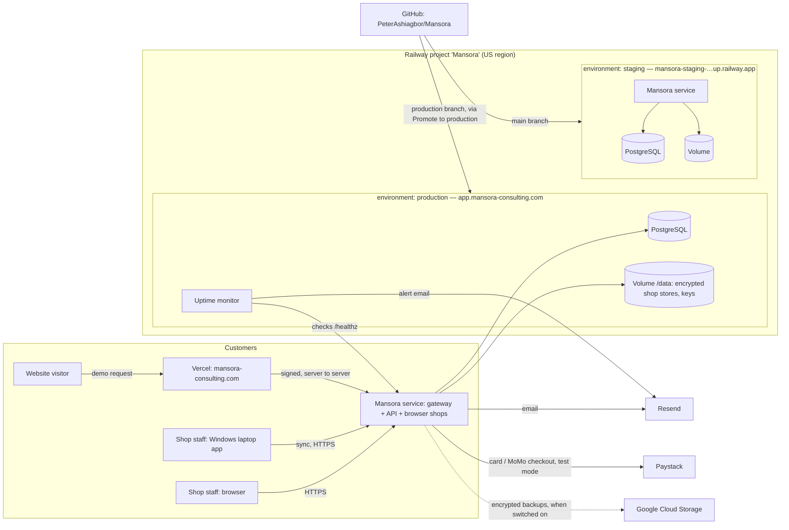

# Railway control register — Mansora Sales & Stock

Answers to *Railway.app: A Practical Guide for Business and Technology Oversight* (sections 5–8) for the actual
system. Status on 15 November 2026. ✅ in place and evidenced · ◐ partly in place · ❌ open. "Owner action" means it
needs a person with that account; the rest is done or tracked in the repository.

## 1. What runs where

Railway hosts the **application, the database and the monitor**; nothing else runs there. Laptops keep their own
encrypted database and sync to Railway when online.

## 2. Section 6 questions, answered

| # | Question | Answer | Status |
| --- | --- | --- | --- |
| 1 | What does Railway host? | Three services per environment: the Mansora web service (public gateway, API, browser shops), PostgreSQL, and (production only) an uptime monitor. Two volumes: database data and `/data` (encrypted shop stores, keys). | ✅ |
| 2 | Who owns the account, code, domain and data? | Code: GitHub `PeterAshiagbor/Mansora` (Peter). Website code: `priscillafm03-afk/mansora-website` (Priscilla's personal account). Railway account owner, Vercel team "mansora" owner and the domain registrar account (GoDaddy, mansora-consulting.com) are **not yet recorded**. Production data: Mansora as processor for each shop (the shop is controller of its business data). | ❌ Owner action: record the named owner of each account below |
| 3 | Is production separated? | Yes since 15 Nov 2026: Railway `staging` (own database/volume, auto-deploys main) and `production` (deploys only the `production` branch). See `environments.md`. | ✅ |
| 4 | Who can access live / deploy? | Deploy: anyone who can run *Promote to production* (repository write access); add required reviewers to make it an approval. Railway project members: **not yet listed**. | ◐ Owner action: list Railway members; add required reviewers |
| 5 | MFA and role-based access? | Application: role permissions for owner/manager/cashier are enforced and tested; administrator two-step sign-in is built but **not enabled** on the main administrator account (signed in with password only on 14 Nov). Railway/GitHub/Vercel/Resend/Paystack MFA: **not confirmed**. | ◐ Owner action: enable two-step sign-in in the admin (Account security) and MFA on every provider account |
| 6 | Where is data hosted; what rules apply? | Railway US region; Google bucket region to choose (suggest europe-west1 or africa-south1); Resend (email) and Paystack (payments) process limited data. Ghana Data Protection Act 2012 applies: cross-border transfer and sub-processors must be recorded. Inventory: `docs/legal/data-inventory.md`. | ◐ Owner action: Data Protection Commission registration; record transfers |
| 7 | Are backups automated; how often; kept how long? | Laptop: optional daily encrypted backup (owner switches on) + cloud sync. Browser version: off-site encrypted backups every 6 h to Google Cloud Storage, kept 90 days — **built and tested but off until the bucket exists** (`docs/disaster-recovery/system-backups.md`). Railway's own volume backups: **none, and unavailable on the current plan** (checked 16 Nov 2026: Railway requires a Pro workspace for backups and schedules). Production currently has **no backup of any kind**; see `../disaster-recovery/rehearsal-2026-11-16.md`. | ❌ Owner action: create the bucket (20 min); confirm Railway plan backups |
| 8 | Last successful restore test? | Automated: full snapshot → empty database → shops sign in and reconcile (`tests/staging/full-system-snapshot.test.ts`, `system-backups.test.ts`) on every CI run. **Never on Railway itself.** | ❌ Planned: first witnessed restore into the staging environment once backups are on |
| 9 | RTO / RPO? | Proposed: **RPO 6 hours** (backup interval; laptops lose nothing that synced) and **RTO 4 hours** (new environment + restore + DNS). | ◐ Owner action: approve or change |
| 10 | Monitoring and alerts? | Uptime monitor checks production health; after three failures it emails priscilla@mansora-consulting.com, then reminders and a recovery message. Delivery drill accepted by Resend 14 Nov 2026. Backup health: once backups are on, the alert inbox is emailed after three failed backups in a row or when no verified copy exists for twice the interval (at most every 12 hours), and again when backups recover. No resource or cost alerts yet. | ◐ |
| 11 | Monthly and annual cost? | Not yet measured. Target in the Railway guide: $5–$15/month for team testing; Resend and Paystack per use (Paystack 1.95% local cards/MoMo); Google storage under $1/month at current size. | ❌ Owner action: read Railway usage and set a usage limit / alert |
| 12 | Exit plan? | Code is in GitHub and builds a standard Docker image (`infrastructure/railway/Dockerfile`) that runs on any container host with PostgreSQL. Data leaves through the encrypted system snapshot, which `scripts/recovery/restore.ts` restores into any empty PostgreSQL and folder. Domain moves by DNS. | ◐ Prove once with the staging restore |
| 13 | Documentation, architecture, procedures? | `../architecture/system-design.md` (components, environments, data flows, trust boundaries, limits), this register, `runbook.md` (roles, severity, incident procedure, operating calendar, access review, joiners/leavers), `environments.md`, `incident-response.md`, `backup-and-recovery.md`, `system-backups.md`, `uptime-monitor.md`, user guides. | ✅ |
| 14 | Who is accountable? | Business owner: Peter (Mansora Consulting). Technical owner, incident responder, security updates, vendor management: **to name**. | ❌ Owner action: name them in section 4 |

## 3. Section 7 minimum checklist

| Control | Status | Evidence / next step |
| --- | --- | --- |
| Named business and technical owner | ◐ | Business: Peter. Technical: to name (section 4). |
| Architecture and data flows documented | ✅ | `../architecture/system-design.md`; diagram above; `docs/legal/data-inventory.md` for every stored field. |
| Production, staging, development separated | ✅ | `environments.md` (15 Nov 2026). |
| Access approved, role-based, reviewed | ◐ | Roles enforced in the app; quarterly access review and joiner/leaver steps defined in `runbook.md` sections 5–6; first review to run. |
| MFA where available | ❌ | Enable on admin account and every provider account. |
| Secrets stored securely, not in code | ◐ | All secrets in Railway/Vercel variables or the encrypted volume; none in code (checked in CI). **Some test passwords were pasted into chat on 14 Nov — rotate them.** |
| Backups configured, monitored, restore-tested | ❌ | Built and tested in CI; switch on after the bucket; first restore drill into staging. |
| Changes tested, approved, traceable | ◐ | 20 CI checks on every PR; staging; *Promote to production* records approver and contents. Branch protection and required reviewers still to switch on (repository admin). |
| Logs, metrics, security events monitored | ◐ | Uptime alerts live; audit logs in the app and admin; Railway logs. No resource/cost alerts yet. |
| Incident response, continuity, DR documented and tested | ◐ | `runbook.md` (roles, severity, response times, procedure, templates, reviews), `incident-response.md`, `backup-and-recovery.md`; DR not yet rehearsed on Railway. |
| Costs, usage, vendor terms reviewed | ❌ | Set a monthly review and a Railway usage limit. |
| Data ownership, portability, retention, deletion documented | ◐ | Inventory and retention proposals in `docs/legal`; retention periods await legal/owner decision. |

## 4. People (owner to complete)

| Role | Name | Accounts held |
| --- | --- | --- |
| Business owner | Peter | GitHub (Mansora repository) |
| Technical owner | *to name* | |
| Incident responder (receives alerts) | *to name* — alerts go to priscilla@mansora-consulting.com | |
| Railway account owner | *to name* | |
| Vercel team "mansora" owner | *to name* | |
| Domain registrar (GoDaddy) owner | *to name* | |
| Resend, Paystack, Google Cloud owners | *to name* | |

## 5. Financial-services considerations (guide section 8)

Mansora records sales, payments, credit, VAT and Mobile Money for shops: an important system for its clients. In
place: integer money (pesewas) everywhere, append-only audit history, offline-first laptops with their own
encrypted copy, reconciliation of payments to Mobile Money and bank statements, signed payment and email webhooks,
tenant isolation tested on every change. Interfaces: Paystack (payments, test mode until the live go-ahead), Resend
(email), Google Cloud Storage (backups, pending), Vercel website (signed demo requests). Each is documented with its
owner, credentials location, error handling and audit trail in `docs/billing`, `docs/operations` and
`docs/operations/acquisition`.
